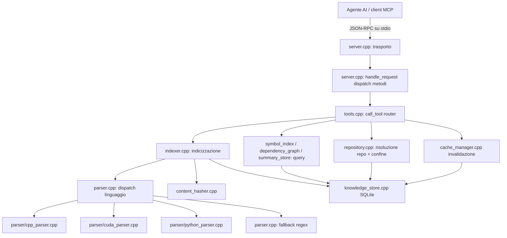

# 01 — Architettura

## 1. Idea di fondo

AI-Tools è un **motore di conoscenza di repository** esposto come server MCP. Il principio guida: l'agente AI non deve mai ricostruire la conoscenza da zero; il server la possiede, la mantiene aggiornata in modo incrementale e la serve già pronta.

Cinque principi e come sono implementati:

| Principio | Implementazione |
|---|---|
| Conoscenza posseduta dal server | Ogni tool legge da SQLite (`knowledge_store`), mai dal filesystem quando i dati sono freschi |
| Incrementale > completo | `index_repository()` riprocessa solo i file il cui hash è cambiato |
| Validità via hash | Ogni artefatto (simboli, edge, riassunti) salva l'hash del contenuto all'indicizzazione |
| Isolamento repository | Un database per repo; `repo_id` = SHA-256 del path canonico della root |
| Degradazione graziosa | Un file che non si parsifica non ferma l'indicizzazione del resto del repo |

## 2. I livelli



### Livello 1 — Trasporto (`src/main.cpp`, `src/server/server.cpp`)

`main()` fa solo due cose: `server::init()` e `server::run()`.

`run()` è il loop del trasporto stdio MCP: legge una riga alla volta da stdin. Due framing accettati:
- **newline-delimited JSON** (standard MCP stdio): ogni riga è un messaggio JSON-RPC completo;
- **Content-Length framing** (stile LSP): legge l'header, scarta le righe di header fino alla riga vuota, legge esattamente N byte di body.

Ogni messaggio passa a `handle_request()`, che fa il dispatch dei metodi MCP:

| Metodo | Risposta |
|---|---|
| `initialize` | `protocolVersion`, `capabilities.tools`, `serverInfo` |
| `notifications/initialized` | nessuna risposta (notifica) |
| `ping` | risultato vuoto |
| `tools/list` | array dei 10 tool con schema JSON |
| `tools/call` | invoca `tools::call_tool` e incapsula il risultato in `result` |
| metodo sconosciuto | errore `-32601` |
| JSON malformato | errore `-32600` |

Le risposte sono sempre JSON su una riga con `id` eco della richiesta. Le notifiche (senza `method` o con `method` `notifications/*`) non producono output.

### Livello 2 — Router dei tool (`src/server/tools.cpp`)

`call_tool(name, arguments)` è il cuore del livello tool. Prima di ogni operazione:

1. **Risoluzione repository** (`resolve_repo`): se l'argomento contiene `repo_id`, cerca il repo nel registry globale e apre il suo database; altrimenti se contiene `path`, deduce la root (directory stessa o parent del file) e crea/riapre il repository. Da qui in poi ogni query è vincolata a `repo_id`.
2. **Guardia di confine** (`guarded_path`): ogni path utente viene canonizzato (`weakly_canonical`) e verificato dentro la root del repository (`path_utils::is_within_repository`). Un path che esce dal confine (es. `../../etc/passwd`) produce un errore del tool, non un accesso.
3. **Dispatch su nome tool** → handler dedicato (vedi [05-tools.md](05-tools.md)).
4. **Confezionamento MCP**: ogni handler ritorna `tool_result(payload)` o `tool_error(messaggio)`, cioè:

```json
{"content":[{"type":"text","text":"<payload JSON serializzato>"}],"isError":false}
```

Il server (`server.cpp`) aggiunge poi `structuredContent` con il payload JSON completo. I campi "bulk" (il corpo del file in `content`) viaggiano **una sola volta**: restano in `structuredContent` e vengono rimossi dal text block, che conserva i metadati più un marcatore `<field>_omitted`.

### Livello 3 — Motore (`src/engine/`)

#### repository.cpp — identità e isolamento
Ogni repository ha un'identità **deterministica**: `repo_identity(root)` = primi 16 hex di SHA-256 del path assoluto canonico. Il database del repo vive in `~/.ai-tools/repos/<identity>/knowledge.db`. Un registry globale (`~/.ai-tools/registry.db`) mappa `repo_id → root_path`, così i tool possono cercare tra tutti i repository conosciuti. La stessa tabella `repositories` è replicata anche nel database del repo, così l'indexer può risolvere `repo_id → root_path` localmente.

#### knowledge_store.cpp — SQLite
Wrapper sottile su sqlite3: `open()` crea lo schema (6 tabelle, vedi [04-data-model.md](04-data-model.md)), imposta `WAL`, `busy_timeout=5000`, `foreign_keys=ON`. `execute()`/`query()` usano **prepared statement in cache** (`prepare_cached`: mappa SQL→stmt, con `reset`+`clear_bindings` a ogni riuso) per evitare di ricompilare SQL a ogni chiamata. I parametri sono legati tutti come testo (la variadic template converte gli integrali in stringa).

#### content_hasher.cpp — SHA-256
`compute_file_hash()` legge il file in blocchi da 4096 byte e aggiorna l'hash **anche sull'ultimo blocco parziale** (bug storico corretto: `read()` restituisce false sull'ultimo read corto, ma `gcount()` conta i byte letti). `compute_string_hash()` per l'identità dei repository.

#### parser.cpp + parser/* — parsing
`get_language_from_extension()` mappa le estensioni ai linguaggi. `parse_file()` dispatcha:
- `c`/`cpp` → `parse_cpp()` (tree-sitter-c o tree-sitter-cpp a seconda dell'estensione)
- `cuda` → `parse_cuda()` (grammar cpp + riconoscimento qualificatori `__global__`/`__device__`/`__host__`/`__shared__`)
- `python` → `parse_python()` (tree-sitter-python)
- altro → **fallback regex** (`regex_extract_symbols` / `regex_extract_dependencies`): pattern basilari per class/function/import, nessun understanding semantico.

Ogni parser tree-sitter visita l'AST e produce `FileMetadata`:
- **simboli**: namespace, class, struct, union, enum, function, typedef, variable, kernel, decorator — con `signature`, `start_line`/`end_line`, `scope` (es. `app::Widget`), `is_declaration` vs `is_definition`
- **dipendenze file**: `#include` / `import` / `from ... import`
- **dipendenze simbolo**: edge `caller → callee` estratti dai nodi AST `call_expression` (C/C++/CUDA) e `call` (Python), con caller qualificato (`indexer::index_file`, `Config.validate`) e riga della chiamata.

Fallimenti isolati: file mancante → metadati vuoti senza crash; AST rotta → l'AST parziale viene comunque usata; ABI tree-sitter incompatibile → metadati base.

#### indexer.cpp — orchestrazione
- `needs_indexing(store, path, repo)`: confronta hash corrente con hash salvato nella tabella `files`.
- `index_file()`: parse → hash → **transazione BEGIN/COMMIT** con: upsert `files`, delete+insert `symbols`, delete+insert edge `include`/`import` (con **risoluzione a file reale** quando il target esiste su disco), delete+insert edge `call` con `source_symbol`/`target_symbol`, update `indexing_state`.
- `index_repository()`: walk ricorsivo (skip `build/`, `.git/`, `node_modules/`, `third_party/`), **salta i file già freschi** (`needs_indexing()==false`), aggiorna `indexing_state` con contatori.

#### cache_manager.cpp — invalidazione
- `invalidate(path)`: cancella simboli, edge e invalida riassunti del file.
- `invalidate_transitive(path)`: per i file che includono il target (edge `include`), invalida simboli e riassunti **senza cancellare gli edge** (lazy: il grafo serve ancora per scoprire i dipendenti).
- `get_stale_files()`: confronta l'hash a disco con quello salvato per ogni file indicizzato.

#### dependency_graph.cpp / symbol_index.cpp / summary_store.cpp — query
- `get_dependencies`/`get_dependents`: edge file-level (escludono `dep_type='call'`).
- `get_all_dependencies`: BFS transitivo con `ankerl::unordered_dense::set` visited.
- `get_callees`/`get_callers`: query sul call graph symbol-level con match su nome bare o qualificato.
- `symbol_index::*`: ricerca per nome pattern, per tipo, per file, dettagli completi.
- `summary_store::*`: riassunti associati all'hash; `get_file_summary` ritorna solo riassunti con `is_valid=1` **e** `content_hash == hash corrente`.

### Livello 4 — Utils (`src/utils/`)

- `path_utils::is_within_repository`: canonicalizza entrambi i path e verifica che il secondo inizi per il primo con confine di segmento (`/` o uguale) — resiste a `..` e prefissi ingannevoli (`/repo2` non è dentro `/repo`).
- `file_utils::read_lines(path, start, end)`: lettura righe 1-based con end=-1 = fino alla fine; `write_file`, `read_file`, `walk_directory` (skip directory non-source).

## 3. Ciclo di vita completo di una richiesta (esempio reale)

Richiesta: `tools/call` con `dependency_graph` su `symbol="compute_file_hash", direction="in"`, `repo_id="a386c17ff522c568"`.

```
client ──JSON──▶ run() legge riga
  └▶ handle_request(): parse, method="tools/call"
      └▶ call_tool("dependency_graph", args)
          ├▶ resolve_repo(): lookup_repository(repo_id) nel registry.db
          │     └▶ apre ~/.ai-tools/repos/a386.../knowledge.db
          ├▶ args contiene "symbol" → ramo symbol-level
          │     └▶ dependency_graph::get_callers(store, repo_id, "compute_file_hash")
          │           └▶ SQL: SELECT DISTINCT target_symbol... WHERE dep_type='call'
          │                AND (source_symbol = ? OR source_symbol LIKE ?)
          │                JOIN files ...
          └▶ tool_result({symbol, callers:[...]}) → JSON
  └▶ make_result(result, id) → cout << JSON << "\n"
```

## 4. Ciclo di vita dell'indicizzazione

```
index tool (repo_id o path)
  ├ primo uso: get_or_create_repository() → registry + knowledge.db creati
  ├ index_repository():
  │     walk file con estensioni supportate
  │     per ogni file: needs_indexing()?
  │        ├ NO (hash invariato) → skip  ← il cuore dell'incrementale
  │        └ SÌ → index_file():
  │              parse (tree-sitter o regex)
  │              hash SHA-256
  │              BEGIN
  │                files upsert · symbols replace · include edges replace
  │                call edges replace · indexing_state update
  │              COMMIT
  └ ritorna {files_indexed, files_total}
```

Misura reale su questo repository: full index ≈ 2.0 s, re-index incrementale con tutto fresco ≈ 0.2 s.

## 5. Dipendenze esterne

| Libreria | Uso | Dove |
|---|---|---|
| tree-sitter runtime | parsing AST | `third_party/tree-sitter/usr/lib/.../libtree-sitter.a` |
| grammars c/cpp/python | grammars AST | `third_party/grammars/*/src/parser.c` (scanner.c per cpp/python) |
| sqlite3 | knowledge store | sistema (`pkg_check_modules`) |
| openssl | SHA-256 | sistema |
| nlohmann/json | JSON-RPC e payload | `third_party/usr/include` |
| ankerl unordered_dense | mappe/set hash | `third_party/ankerl-unordered_dense` |
